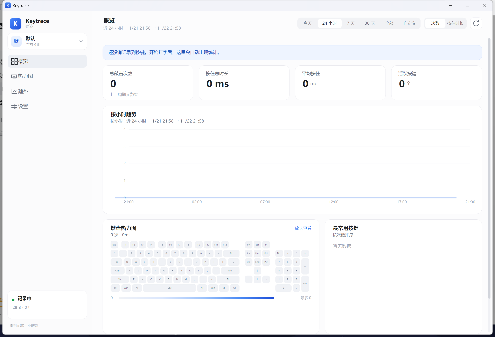
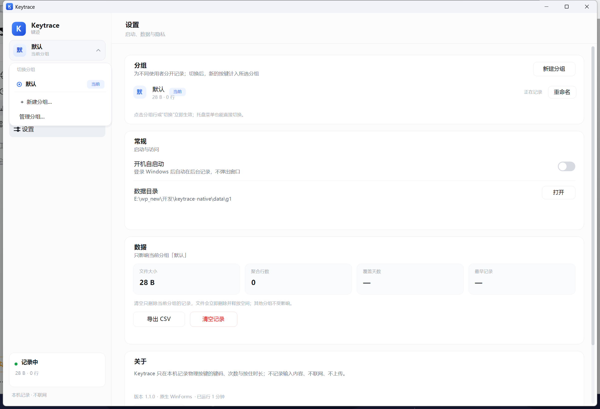

# Keytrace

记录键盘上每个键按了多少次、按住了多久。数据只存在本机，不联网。

用 C# WinForms 写的，编译后只有一个 exe，不需要 Python、Node 或 WebView2。平时在后台占 34 MB 左右：按键先记在内存，每 10 秒批量写盘，按小时聚合。

多人共用一台电脑时可以建多个分组，各记各的。



## 使用

双击 `Keytrace.exe`。关窗口只是隐藏到托盘，记录继续；退出在托盘右键菜单里。

- 概览：总次数、按住总时长、小时趋势、最常用按键
- 热力图：完整键盘布局，可在次数 / 按住时长之间切换
- 趋势：按小时、时段、星期统计
- 设置：分组、开机自启、导出 CSV、清空记录

左下角的分组卡片可以切换或新建分组，`Ctrl+G` 也能打开；托盘右键同样能切。



命令行参数：

```bat
Keytrace.exe --background    # 只后台记录，不显示窗口
Keytrace.exe --view 2        # 打开并切到热力图（1 概览 / 2 热力图 / 3 趋势 / 4 设置）
Keytrace.exe --group 2       # 切换到 2 号分组
Keytrace.exe --reset         # 清空当前分组的记录
```

## 数据

数据在 exe 同级的 `data\` 目录，按分组分开：

```
data\groups.txt   分组列表
data\active.txt   当前分组
data\g1\          默认分组（hourly.bin + journal.bin）
data\g2\          其他分组
```

记录按 UTC 小时存储，界面按本地时区显示。清空只影响当前分组；删除分组会连目录一起删。

## 构建

```
build.bat
```

调用系统自带的 .NET Framework 4.x 编译器（`csc.exe`），源码在 `src\`，不用装 .NET SDK。

## 说明

- 只支持 Windows 10 / 11
- 普通权限进程看不到管理员窗口里的按键，需要以管理员身份运行
- 分组是应用内的，不是 Windows 账户隔离
- 不迁移旧 Python 版（SQLite）的数据

当前版本：1.0.0
